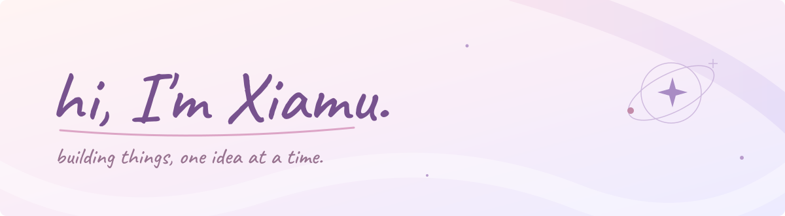

### 夏目 / Xiamu

Building AI agents and tools for everyday work. Exploring, making, and sharing what I learn.

[Website & writing](https://www.xiamu.cc/) · [Projects](https://github.com/cytlabs?tab=repositories)

### Currently building

**Intent** · Personal agent · In development

### Selected projects

| Project | What it does | Stage |
| :--- | :--- | :--- |
| [ssh-mcp](https://github.com/cytlabs/ssh-mcp) | Real SSH terminals and file transfers for AI clients over MCP. | Dev preview |
| [skill-quality-reviewer](https://github.com/cytlabs/skill-quality-reviewer) | AI-led reviews of agent skills, with evidence and forward testing. | Experimental |
| [personal-site](https://github.com/cytlabs/personal-site) | My website, writing, and an interactive space to explore. | Live site |

### Around here

Agents · Developer tools · Infrastructure

Small experiments, useful tools, and notes along the way.
